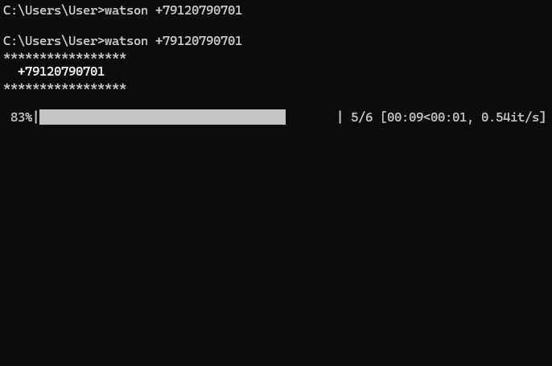

<p align="center">
  
</p>

<h1 align="center">Watson</h1>

<p align="center">
  <strong>CLI tool for phone number account lookups.</strong><br>
  Check supported services, follow live progress, and export results as JSON.
</p>

<p align="center">
  <code>Python 3.11+</code> &nbsp;·&nbsp;
  <code>Supported OS: Windows &amp; Linux</code> &nbsp;·&nbsp;
  <code>Text &amp; JSON</code> &nbsp;·&nbsp;
  <code>7 services</code>
</p>

<p align="center">
  <a href="#demo">Demo</a> &nbsp;·&nbsp;
  <a href="#installation">Installation</a> &nbsp;·&nbsp;
  <a href="#supported-services">Services</a> &nbsp;·&nbsp;
  <a href="#usage">Usage</a> &nbsp;·&nbsp;
  <a href="#options">Options</a>
</p>

---

## Demo

<p align="center">
  
</p>

The recording shows one run. Results depend on each service's response at the time of the lookup.

## Installation

**Requirements:** Python 3.11 or newer, Git, and an internet connection. Amazon and Snapchat also require Google Chrome.

### Windows

Install [Python](https://www.python.org/downloads/windows/), [Git for Windows](https://git-scm.com/downloads/win), and [Google Chrome](https://www.google.com/chrome/). Then download Watson and install its dependencies in PowerShell:

```powershell
git clone https://github.com/morvein/watson.git
cd watson
py -3 -m venv .venv
.\.venv\Scripts\python.exe -m pip install -r requirements.txt
.\watson.cmd PHONE_NUMBER
```

The launcher uses Watson's own `.venv`; activating it manually is unnecessary.
To use `watson` from any directory, add the folder containing `watson.cmd` to your user `PATH` and reopen your shell.

### Linux

The commands below target **Ubuntu 24.04+ / Debian 12+ on x86-64**, with Python 3.11 or newer. Windows has been tested; Linux end-to-end checks have not yet been verified.

Install the prerequisites, download Watson, and create a local environment:

```bash
sudo apt update
sudo apt install -y git python3 python3-venv python3-pip

git clone https://github.com/morvein/watson.git
cd watson
python3 -m venv .venv
.venv/bin/python -m pip install -r requirements.txt
```

For Amazon and Snapchat, install the browser's system dependencies:

```bash
.venv/bin/python -m playwright install-deps chromium
```

If Google Chrome is not already installed, install it with:

```bash
.venv/bin/python -m playwright install chrome
```

Run Watson from the project folder:

```bash
.venv/bin/python watson.py PHONE_NUMBER
```

Create `.venv` separately on each machine. Python environments are specific to the operating system and installation location.

Replace `PHONE_NUMBER` with your own number in international format, including `+`.
Use `--region` with an ISO country code if the number has no international prefix.

## Supported services

| Service | Select with | Runs by default |
| --- | --- | :---: |
| Instagram | `--instagram` | Yes |
| Amazon | `--amazon` | Yes |
| Microsoft | `--microsoft` | Yes |
| Facebook | `--facebook` | Yes |
| Odnoklassniki | `--odnoklassniki` or `--ok` | Yes |
| Snapchat | `--snapchat` | Yes |
| Zoho | `--zoho` | No — select explicitly |

Select one or combine several service flags. The default run checks **six services**; Zoho runs only when requested.

## Usage

The examples use the Windows `watson` shortcut. On Linux, replace `watson` with `.venv/bin/python watson.py` while in the project folder; the same flags apply.

### Run a lookup

```powershell
# Default services
watson PHONE_NUMBER

# Select services
watson PHONE_NUMBER --instagram --microsoft

# Include additional fields and per-service timing
watson PHONE_NUMBER --details

# Check Zoho separately
watson PHONE_NUMBER --zoho
```

The comma-separated form is also supported: `watson PHONE_NUMBER --services instagram,amazon`.
Use either `--services` or individual service flags in a command.

### Export results

```powershell
# Print compact JSON
watson PHONE_NUMBER --json

# Save JSON while keeping formatted output
watson PHONE_NUMBER --output results.json
```

Nothing is saved by default. With `--output`, the file is updated as checks finish.

### Inspect before running

These commands do not send the number to a service:

```powershell
# List available methods and requirements
watson methods

# Preview the selected checks
watson PHONE_NUMBER --dry-run

# Inspect number formatting and metadata
watson normalize PHONE_NUMBER
```

## Reading the output

The live progress bar shows completed checks, elapsed time, estimated remaining time, and checks per second.

| Marker | Color | Meaning |
| :---: | --- | --- |
| `[+]` | Green | Registered — the service recognized the identifier at the lookup step |
| `[-]` | Purple | Not registered — the service did not find the identifier at that step |
| `[?]` | Red | Rate limit — no registration conclusion |
| `[!]` | Red | Unknown, authentication required, or manual action required |
| `[x]` | Red | Error — the check could not complete |

Available Odnoklassniki profile fields and Microsoft email hints appear below their service rows. Use `--details` for all available fields and per-service timing. Masked values stay masked; account data retains the service's original language.

<details>
<summary><strong>Example JSON output</strong></summary>

```powershell
watson +12025550123 --instagram --microsoft --json
```

```json
{
  "instagram": {"status": "registered"},
  "microsoft": {"status": "not registered"}
}
```

The number and results in this JSON example are fictional. JSON includes each service's status and any returned fields, omitting timestamps, method descriptions, and empty fields.

</details>

## Options

| Option or command | Purpose |
| --- | --- |
| `--json` | Print compact JSON instead of formatted output |
| `--output FILE` | Save results as JSON as checks complete |
| `--details` | Show additional fields and per-service timing |
| `--region CODE` | Set an ISO region for a number without `+` |
| `--dry-run` | Show the plan without network requests |
| `--timeout SECONDS` | Set an overall timeout; unlimited by default |
| `--amazon-interactive` | Open Chrome for manual Amazon CAPTCHA |
| `--snapchat-interactive` | Open Chrome for manual Snapchat CAPTCHA |
| `methods` | List lookup methods and requirements |
| `normalize PHONE_NUMBER` | Show number formats and metadata locally |
| `open SERVICE` | Open a service's official page |

The short form `watson PHONE_NUMBER` allows identifier/recovery requests. With the explicit `check` subcommand, add `--allow-recovery`:

```powershell
watson check PHONE_NUMBER --instagram --allow-recovery
```

Press **Ctrl+C** to cancel. Each network operation has its own timeout.

## Lookup behavior

Checks stop before password submission or SMS/OTP requests. CAPTCHA alone does not confirm registration. A result applies to the specific sign-in or recovery step and does not verify number ownership. Service responses can change.

Browser checks use temporary sessions rather than a personal Chrome profile.

---

Third-party attribution and license texts are listed in [THIRD_PARTY_NOTICES.md](THIRD_PARTY_NOTICES.md).
